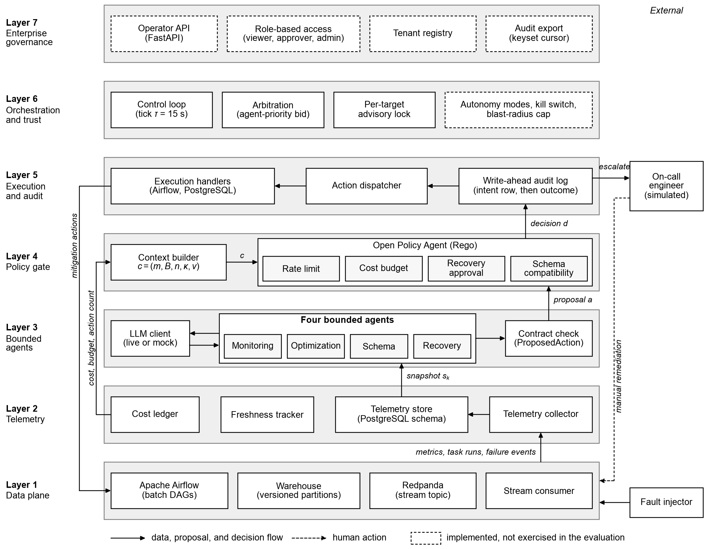
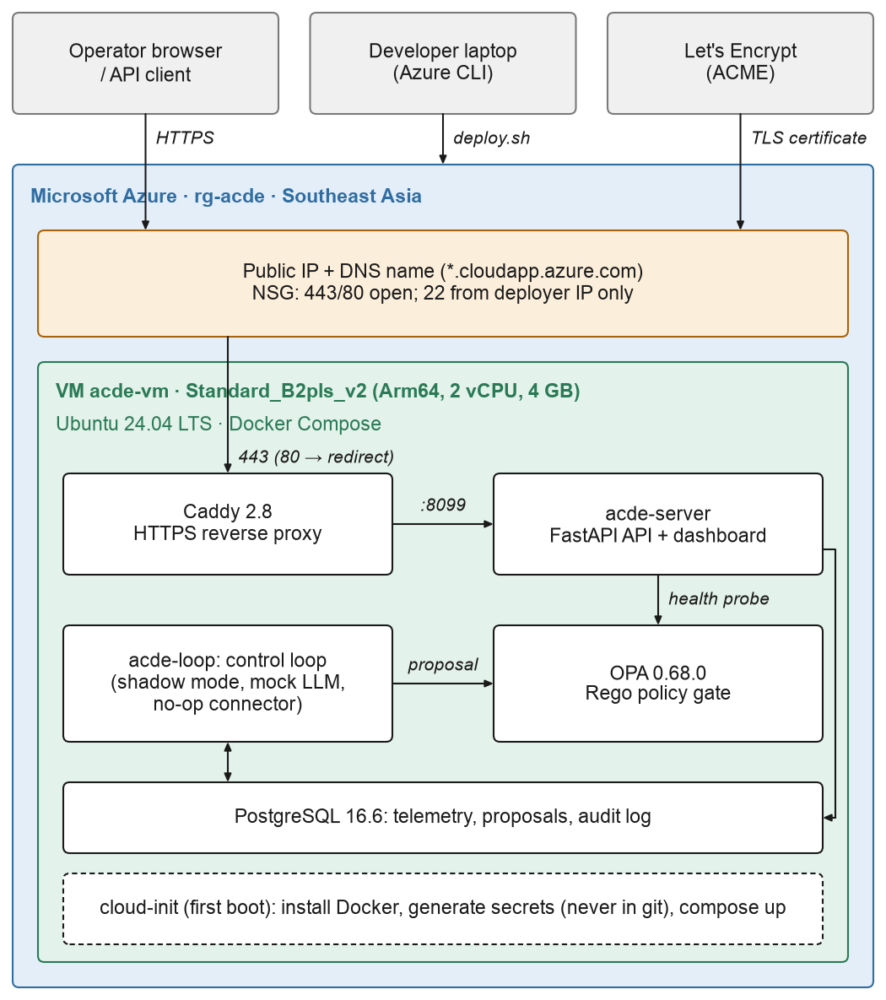

<div align="center">

# ACDE · Agentic Cloud Data Engineering

**Policy-bounded AI agents that govern cloud data pipelines, with every action checked by a policy gate first.**

[](LICENSE)
[](https://github.com/bodapatisaikrishna/agentic-cloud-pipeline-governance/actions/workflows/ci.yml)
[](pyproject.toml)
[](https://github.com/bodapatisaikrishna/agentic-cloud-pipeline-governance/tags)
[](tests/unit)
[](docs/SECURITY.md)

[Architecture](#architecture) · [Results](#results-live-campaign) · [Quickstart](#quickstart) ·
[Cloud deployment](#cloud-deployment-microsoft-azure) · [Paper](#paper-and-submission-package) ·
[Docs](#documentation)

</div>

---

Four bounded agents (**monitoring**, **optimization**, **schema**, **recovery**) watch pipeline
telemetry, reason with a language model, and **propose** operational actions. An **Open Policy Agent
(OPA) gate** validates every proposal before anything runs. Agents never touch a pipeline directly
and never generate code: their only output is a typed `ProposedAction`. Safety comes from the
architecture, not from trusting the model.

ACDE is two things at once:

- **A reproducible research artifact** that replicates and stress-tests
  *[Governing Cloud Data Pipelines with Agentic AI](https://arxiv.org/abs/2512.23737)*
  (arXiv:2512.23737) with a 560-run live-model campaign, non-LLM baselines and an adversarial safety
  evaluation. The results are written up as an IEEE journal manuscript in [`paper/`](paper/).
- **A deployable governance tool** with graduated autonomy (shadow → approval → autonomous), an
  approval queue, a kill switch, per-target blast-radius caps, an operator API and dashboard, and a
  connector boundary for your own Airflow.

## Highlights

- 🛡️ **Policy before action.** Four Rego policy packs (rate limit, cost budget, recovery approval,
  schema compatibility). If OPA is unreachable the gate escalates to a human; it never allows by
  default.
- 🧪 **Live, not just mocked.** The same code path runs under a deterministic mock *and* a real
  remote model (NVIDIA Nemotron, temperature 0). The two disagree by **1,219×** on recovery time,
  which is the project's central finding.
- ⚖️ **Fair baselines.** Agents are compared with static orchestration *and* with cheap non-LLM
  automation (a rule-based responder and a threshold autoscaler).
- 🎯 **Correctness, not just speed.** A `decision_correct` metric scores whether the executed
  mitigation was an accepted one.
- 🔒 **Adversarially tested.** 5,547 generated cases graded by an independent oracle: all **3,867
  unsafe proposals contained**, 0 fail-open.
- 📊 **Every number regenerable.** Tables, figures and every number in the paper are rebuilt from
  committed data with one command.

## Architecture

<p align="center">
  
</p>

The system has **seven layers**, grouped by tint into the base design's three logical planes plus an
enterprise extension. The numbered black markers in the figure trace one control-loop tick:

| Step | What happens | Code |
|---|---|---|
| **1** | The collector turns Airflow task runs, resource usage, freshness and failure events into telemetry rows | `telemetry/collector.py` |
| **2** | Each tick, a `TelemetrySnapshot` is built from PostgreSQL | `contracts/telemetry.py` |
| **3** | Agents reason with the LLM client (live or mock) and propose one action each | `agents/`, `llm/client.py` |
| **4** | The proposal is validated against the typed contract (allowlisted action types, valid targets) | `contracts/actions.py` |
| **5** | The context builder adds cost, budget, recent-action count and schema compatibility; OPA decides allow / deny / escalate | `policy/gate.py`, `infra/opa/policies/` |
| **6** | An intent row is committed to the write-ahead audit log, then the dispatcher calls the handler | `policy/executor.py` |
| **7** | Handlers act on Airflow (trigger, clear, pool slots) or PostgreSQL (rollback, quarantine, mapping) | `policy/executor.py`, `dataplane/partitions.py` |

Conflicts on one target are settled by a static priority bid (recovery > schema > optimization), and
a per-target PostgreSQL advisory lock stops two processes acting at once. Everything durable lives in
PostgreSQL, so the control loop is stateless: kill it and it resumes cleanly. Dashed boxes in the
figure are implemented and unit-tested but were not exercised in the evaluated campaign.

<details>
<summary><b>The four agents</b></summary>

| Agent | Role | Allowed actions |
|---|---|---|
| Monitoring | Detector, enabled in every agent configuration; flags task failures, freshness breaches, CPU pressure and breaking schema drift with static thresholds | raise anomaly, escalate |
| Optimization | Right-sizes resources within the cost policy | scale workers, adjust pool slots, reprioritize |
| Schema | Accepts compatible changes, contains breaking drift | allow compatible, apply mapping, quarantine partition, block ingestion |
| Recovery | Restores a failed pipeline | retry with backoff, replay, rollback, partial recompute, escalate |

Invalid model output is rejected, logged as `agent_output_invalid`, and the turn degrades to
`no_action`.
</details>

## Results (live campaign)

**560 runs**, zero aborts: 240 live-agent, 240 non-agent and 80 mock-model runs, across 8
configurations and 4 seeded fault scenarios (schema drift, upstream delay, resource contention,
ingress burst), on one Apple M2 host with runs strictly sequential. Medians, with bootstrap 95% CIs,
Cliff's δ and Holm-corrected Mann–Whitney tests in the paper.

| Configuration | MTTR (s) ↓ | Cost (units) ↓ | Manual interventions ↓ |
|---|---:|---:|---:|
| Static orchestration (baseline) | 378 | 158 | 1 |
| Rule-based automation | **30** | 158 | **0** |
| Threshold autoscaling | 52 | 82.5 | 0.5 |
| **Full agent system (live model)** | 235 | **69.8** | 6 |
| Full agent system (deterministic mock) | 0.19 | 833 | 0 |

**What this means, against the base paper's claims:**

| Base paper claim | Measured (live) | Verdict |
|---|---|---|
| MTTR down up to 45% | ↓38% (378 s → 235 s), p < 0.001 | Partly; smaller than claimed |
| Cost down about 25% | ↓56% (158 → 69.8 units) | Mostly from an assumed provisioning gap |
| Manual interventions down more than 70% | ↑500% (1 → 6) | Does not reproduce |
| Correct mitigation (not reported) | 42% of live runs vs 100% under the mock | Speed ≠ correctness |

The headline lesson is about evaluation: **the same code, under a mock model, looks 1,219× faster
and perfectly correct.** Treat mock and live results as separate findings until both exist.
Two idealized non-LLM baselines recover faster still; their fixed 30 s / 20 s actions are assumptions,
not measurements of a real controller. Full analysis, threats to validity and the cost-measurement
caveats are in the paper.

## Quickstart

**Reproduce the paper (no API cost, under 15 minutes):**

```bash
git clone https://github.com/bodapatisaikrishna/agentic-cloud-pipeline-governance.git
cd agentic-cloud-pipeline-governance
uv sync --extra research          # venv from the committed uv.lock
make paper-repro-quick            # regenerate every table, figure and number, then build the PDF
```

**Run the stack and the tests (MOCK_LLM=1 by default, zero API calls):**

```bash
cp .env.example .env              # defaults work
make lint && make test-unit       # ruff + mypy clean, 774 unit tests, coverage ≥ 80%
make up && make seed              # PostgreSQL, OPA, Redpanda, Airflow + seeded data
make experiment-quick             # 96-run matrix (8 configs × 4 scenarios × 3)
make report                       # → results/results.md + results/figures/
```

**Deploy against your own Airflow (shadow mode by default):**

```bash
cp .env.prod.example .env.prod    # API key, database password, Airflow and LLM settings
docker compose -f deploy/docker-compose.prod.yml up -d --build
acde doctor                       # validate, then `acde run`
```

<details>
<summary><b>Live paper campaign (costs API calls)</b></summary>

```bash
make campaign-pilot               # short live pilot at paper timings
make campaign                     # full campaign (~49 h; arms A live, B baselines, C mock)
make campaign-v2                  # v2 re-run: equal n, paired seeds, interleaved, fixed metering (D-105)
make campaign-status              # heartbeat; make campaign-stop to stop resumably
make adversarial-corpus           # adversarial corpus vs the pinned OPA → results/adversarial.json
```

Every run is keyed `"{config}__{scenario}__r{replicate}"` with seed
`sha256("{config}:{scenario}:{replicate}") % 2**32`, and the runner skips runs already in the
manifest, so a killed campaign resumes where it left off. The `paper_v2` profile drops the config
from the seed so every config sees the same faults. See [`docs/CAMPAIGN.md`](docs/CAMPAIGN.md).
</details>

## Cloud deployment (Microsoft Azure)

<p align="center">
  
</p>

The production stack runs on a single Azure VM (`Standard_B2pls_v2`, Arm64, 2 vCPU, 4 GB, Ubuntu
24.04, Southeast Asia). One script provisions it; cloud-init installs Docker, generates every secret
on the machine (never in git) and starts PostgreSQL, OPA 0.68.0, the operator API and the control
loop behind Caddy, which serves HTTPS with a Let's Encrypt certificate. The network security group
opens only 443 and 80, plus SSH from the deployer's IP.

```bash
./deploy/azure/deploy.sh          # needs the Azure CLI and a logged-in subscription
```

It runs in shadow mode with the mock model and a no-op connector, so it proposes but never acts.
Verified: valid certificate, HTTP→HTTPS redirect, 401 on every protected endpoint without a key, and
all 7 readiness checks passing. It was health-checked only; no experiment ran on it. Details and the
Arm64-specific choices are in [`DEVIATIONS.md`](DEVIATIONS.md) (D-104t).

## Paper and submission package

| Path | Contents |
|---|---|
| [`paper/`](paper/) | IEEE journal manuscript (LaTeX), with every number generated from `paper/data/` |
| [`submission_package/`](submission_package/) | `IEEE_Journal_Paper.pdf`, `IEEE_Journal_LaTeX_Source.zip` (Overleaf-ready), `Project_Report.docx` |
| [`scripts/draw_architecture.py`](scripts/draw_architecture.py), [`scripts/draw_deployment.py`](scripts/draw_deployment.py) | Regenerate Fig. 1 and Fig. 2 |

## Documentation

| Doc | What it covers |
|---|---|
| [`docs/OPERATIONS.md`](docs/OPERATIONS.md) | Deploying, the trust ladder, kill switch, observability, upgrades |
| [`docs/CONNECTING.md`](docs/CONNECTING.md) | Attaching ACDE to your Airflow with a least-privilege account |
| [`docs/POLICY_AUTHORING.md`](docs/POLICY_AUTHORING.md) | Writing and testing Rego policies |
| [`docs/SECURITY.md`](docs/SECURITY.md) | Threat model, design guarantees, operator responsibilities |
| [`docs/CAMPAIGN.md`](docs/CAMPAIGN.md) | Running the live evidence campaign |
| [`docs/PAPER_MAPPING.md`](docs/PAPER_MAPPING.md) | Paper section → implementation → measured result |
| [`DEVIATIONS.md`](DEVIATIONS.md) | Every design decision and deviation, with alternatives and rationale |
| [`DATA_LICENSES.md`](DATA_LICENSES.md) | Provenance and licensing of TPC-DS, NYC 311 and NYC TLC data |
| [`CHANGELOG.md`](CHANGELOG.md) | Release history |

<details>
<summary><b>Repository map</b></summary>

```
src/acde/
├── agents/          four agents, shared observe → reason → propose → act loop, detection
├── llm/             LLM client (Anthropic, Gemini, OpenAI-compatible) + deterministic mock
├── contracts/       pydantic contracts: ProposedAction, PolicyDecision, TelemetrySnapshot
├── policy/          OPA gate (fail-safe) and executor (write-ahead audit, retry, escalate)
├── orchestrator/    control loop, priority-bid arbitration, advisory locks, kill switch
├── telemetry/       collector, cost ledger, freshness
├── dataplane/       Airflow batch DAG, Redpanda streaming, versioned partitions
├── chaos/           seeded fault injector and scenarios
├── experiments/     runner, baselines, campaign supervisor, decision quality
├── eval/            adversarial corpus + independent oracle, cross-model harness
├── analysis/        statistics, figures, paper artifacts
├── human/           simulated on-call engineer, approval queue
├── server/          FastAPI operator API, dashboard, metrics, rate limiting
└── connectors/      airflow · prefect · noop
infra/opa/policies/  Rego policies + tests          infra/postgres/init/  idempotent DDL
deploy/              production compose, Helm chart, observability, Azure
tests/unit/          774 tests, no Docker           tests/integration/    needs `make up`
```
</details>

<details>
<summary><b>LLM providers</b></summary>

Set `LLM_PROVIDER` in `.env`. Monitoring uses a fast tier; the reasoning agents use a reasoning tier.

| Provider | Key | Fast tier | Reasoning tier |
|---|---|---|---|
| `anthropic` | `ANTHROPIC_API_KEY` | `claude-haiku-4-5` | `claude-sonnet-4-6` |
| `gemini` | `GEMINI_API_KEY` | `gemini-2.5-flash` | `gemini-2.5-pro` |
| `openai_compatible` (NVIDIA NIM, Groq, OpenRouter, …) | `OAI_API_KEY` | `nvidia/nemotron-3-super-120b-a12b` | configurable |

All run at temperature 0 with per-run budget caps (60 calls, 150,000 tokens), cache identical
proposals within a run, and degrade to `no_action` on any provider failure. The paper campaign used
`nvidia/nemotron-3-ultra-550b-a55b` for reasoning.
</details>

<details>
<summary><b>Fault tolerance</b></summary>

| Dependency down | Behaviour | Where |
|---|---|---|
| OPA unreachable | Gate fails safe and escalates, never allows | `policy/gate.py` |
| Airflow unreachable | Executor retries with bounded backoff, then escalates | `policy/executor.py` |
| PostgreSQL blip | Statement retried (tenacity) | `db.py` |

`tests/integration/test_failure_modes.py` stops the real OPA container to prove the first row.
</details>

## Phase status

| Phase | Scope | Status |
|---|---|---|
| 0–9 | Scaffold → agents/LLM → orchestrator → experiments → analysis → hardening (v1.0) | ✅ verified |
| A–F | Credible baselines, decision quality, cost v2, cross-LLM harness, adversarial eval, packaging (v1.3) | ✅ verified |
| P1–P5 | Trust core, connectors, operator API/CLI, production packaging, game-day + ROI (v2.0) | ✅ verified |
| Tier 1–2 | Docker image, releases, hardened CI, multi-actor auth, dashboard, Prefect connector (v2.1–v2.2) | ✅ verified |
| Hardening | Concurrency fuzzing, OPA audit, bid-based arbitration, migrations, write-ahead audit, Helm, RBAC, multi-tenancy, backups (D-077–D-099) | ✅ verified (unreleased) |
| Feature focus | Live decision-quality monitoring, Slack/PagerDuty, richer dashboard (D-100–D-103) | ✅ verified (unreleased) |
| Journal paper (D-104) | 560-run live campaign (2026-09-26), adversarial corpus, sensitivity analyses, manuscript, Azure deployment (D-104t) | ✅ verified (unreleased) |
| Measurement v2 (D-105) | Incident-level escalations, MTTR from injection, per-run state reset, fixed metering window, paired seeds, `paper_v2` profile | 🟡 unit + integration tested, smoke verified; v2 campaign pending |

## License and citation

ACDE is licensed under the [Apache License 2.0](LICENSE) (see also [`NOTICE`](NOTICE)). This project
is an independent replication and extension of the paper below and is not affiliated with or
endorsed by its authors.

```bibtex
@article{kirubakaran2025governing,
  title   = {Governing Cloud Data Pipelines with Agentic AI},
  author  = {Kirubakaran, Aswathnarayan Muthukrishnan and Parthasarathy, Adithya and Saksena, Nitin
             and Bodala, Ram Sekhar and Deshpande, Akshay and Malempati, Suhas and
             Carimireddy, Shiva and Mazumder, Abhirup},
  journal = {arXiv preprint arXiv:2512.23737},
  year    = {2025}
}
```
